# [springboot]毕业生追踪系统

> 🎓 **计算机毕业设计 · [springboot]毕业生追踪系统**
>
> 本仓库只放**项目介绍 + 运行截图**（截图是站点带水印的原图，存在仓库 `images/` 里）。
>
> 👉 **完整可运行源码 / 数据库脚本 / 部署文档：[点我获取](https://geekcode.top/archives/springboot-%E6%AF%95%E4%B8%9A%E7%94%9F%E8%BF%BD%E8%B8%AA%E7%B3%BB%E7%BB%9F?utm_source=github)**
>
> 💬 咨询微信：**ir9372**　|　🌐 更多项目：[极客代码 geekcode.top](https://geekcode.top/?utm_source=github)
>
> 📌 项目详情页：<https://geekcode.top/archives/springboot-%E6%AF%95%E4%B8%9A%E7%94%9F%E8%BF%BD%E8%B8%AA%E7%B3%BB%E7%BB%9F?utm_source=github>

<table><td width="230" align="center"> <b>扫码加微信 ir9372</b></td><td valign="middle">📦 源码 = 项目介绍 + 全部运行截图 + 数据库 + 部署文档 👉 点上方任意截图，直接跳到 <b>极客代码 geekcode.top</b> 详情页</td></table>

---

<h1>[springboot]毕业生追踪系统</h1>
<h2>项目概述</h2>

本项目为“毕业生追踪系统”，旨在构建一个集前台展示与后台管理于一体的综合信息管理平台，专门服务于高校毕业生的数据记录、去向追踪及资讯发布。系统核心功能涵盖学生信息管理、毕业去向统计、班级档案维护、荣誉表彰记录、深造资讯推送以及证书信息管理。通过整合前后端分离架构，系统实现了数据的实时交互与高效处理。适用人群包括学校教务管理人员、辅导员及广大毕业生用户。技术架构上采用 Spring Boot 作为后端核心框架，结合 MyBatis-Plus 进行持久层操作，并利用 Shiro 实现安全权限控制，前端基于 Vue 生态构建，确保了系统的稳定性、安全性与良好的用户体验。

<h2>技术架构</h2>

本系统采用典型的 B/S（浏览器/服务器）架构，遵循前后端分离的开发模式，具体技术选型如下：

<ol>
<li><strong>后端架构</strong>：</li>
</ol>
<ul>
<li><strong>核心框架</strong>：使用 <code>spring-boot-starter-web</code> 构建 RESTful API 接口，提供高效的 HTTP 服务处理能力。</li>
<li><strong>持久层框架</strong>：集成 <code>mybatis-spring-boot-starter</code> 和 <code>mybatis-plus</code>，利用 MyBatis-Plus 提供的通用 CRUD 方法简化数据库操作，同时保留 MyBatis 灵活的 SQL 编写能力。</li>
<li><strong>数据库连接</strong>：采用 <code>mysql-connector-java</code> 驱动连接 MySQL 数据库，配合 <code>spring-boot-starter-jdbc</code> 进行事务管理和连接池配置。</li>
<li><strong>安全框架</strong>：引入 <code>shiro-spring</code> 实现身份认证（Authentication）和授权（Authorization），确保系统访问的安全性。</li>
<li><strong>辅助组件</strong>：使用 <code>commons-lang3</code> 处理字符串及对象工具类，<code>validation-api</code> 进行参数校验，<code>protobuf-java</code> 可能用于特定数据序列化或通信优化。</li>
</ul>
<ol start="2">
<li><strong>前端架构</strong>：</li>
</ol>
<ul>
<li>项目类型为 <code>vue-integrated</code>，表明前端基于 Vue.js 框架开发，并可能与后端工程进行集成部署或通过 Axios 进行异步数据交互。</li>
<li>前端路由清晰划分为 <code>/index/*</code>（前台页面）和后台管理路径，支持单页应用（SPA）式的流畅体验。</li>
</ul>
<ol start="3">
<li><strong>数据库设计要点</strong>：</li>
</ol>
<ul>
<li>根据后台路由推断，数据库主要包含以下核心实体表：学生信息表（xuesheng）、新闻/资讯表（news）、论坛/交流表（forum）、班级信息表（banji）、毕业去向表（biyequxiang）、荣誉信息表（rongyuxinxi）、深造信息表（shenzaoxinxi）、证书信息表（zhengshuxinxi）以及系统配置表（config）。</li>
<li>各表之间通过外键或逻辑关联建立联系，例如学生表与班级表、毕业去向表存在一对多或多对一关系，以支撑完整的数据追踪链路。</li>
</ul>

<a href="https://geekcode.top/archives/springboot-%E6%AF%95%E4%B8%9A%E7%94%9F%E8%BF%BD%E8%B8%AA%E7%B3%BB%E7%BB%9F?utm_source=github" title="查看完整源码">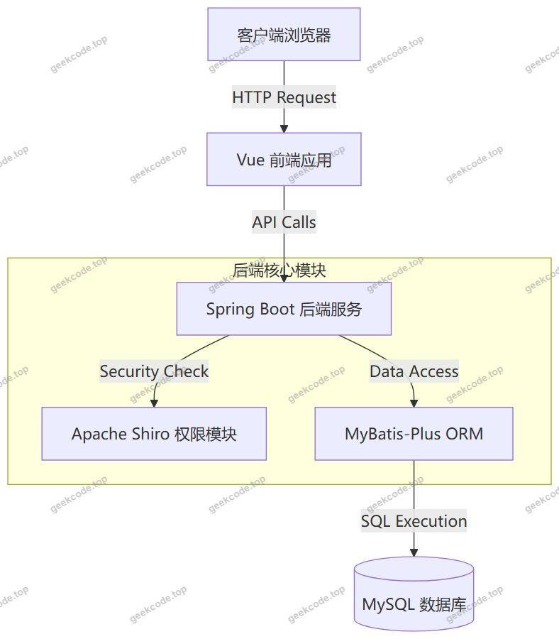</a>

<h2>功能模块</h2>

系统功能分为前台用户端和后台管理端两部分，具体模块描述如下：

<h3>1. 前台用户端</h3>

前台主要面向普通用户（如学生、访客），提供信息浏览、注册登录及个人数据管理服务。

<ul>
<li><strong>首页展示 (<code>/index/newsList</code>, <code>/index/forumList</code>)</strong>：展示最新发布的新闻资讯和论坛动态，作为系统的入口门户。</li>
<li><strong>用户注册与登录 (<code>/xueshengRegister</code>, 登录页)</strong>：提供学生账号的注册通道及登录验证功能，保障用户身份的唯一性。</li>
<li><strong>学生信息管理 (<code>/index/xueshengList</code>, <code>/index/xueshengDetail</code>, <code>/index/xueshengAdd</code>, <code>/index/xueshengCenter</code>)</strong>：</li>
<li>列表页：查看已登记的学生基本信息。</li>
<li>详情页：查看特定学生的详细档案。</li>
<li>添加页：允许录入新的学生基础数据。</li>
<li>个人中心：用户可在此查看和管理自己的个人信息及相关状态。</li>
<li><strong>毕业去向追踪 (<code>/index/biyequxiangList</code>, <code>/index/biyequxiangDetail</code>, <code>/index/biyequxiangAdd</code>)</strong>：展示历届毕业生的就业或升学去向统计数据，支持新增去向记录。</li>
<li><strong>荣誉信息管理 (<code>/index/rongyuxinxiList</code>, <code>/index/rongyuxinxiDetail</code>, <code>/index/rongyuxinxiAdd</code>)</strong>：展示优秀毕业生的荣誉奖项，支持荣誉记录的查询与录入。</li>
<li><strong>班级管理 (<code>/index/banjiList</code>, <code>/index/banjiDetail</code>, <code>/index/banjiAdd</code>)</strong>：提供班级信息的浏览、详情查看及新建班级功能。</li>
<li><strong>证书信息管理 (<code>/index/zhengshuxinxiList</code>, <code>/index/zhengshuxinxiDetail</code>, <code>/index/zhengshuxinxiAdd</code>)</strong>：展示各类职业资格证书或学历证书的颁发情况，支持证书数据的维护。</li>
<li><strong>深造资讯 (<code>/index/shenzaoxinxiList</code>, <code>/index/shenzaoxinxiDetail</code>, <code>/index/shenzaoxinxiAdd</code>)</strong>：发布考研、留学等深造相关的政策资讯及成功案例，支持资讯的动态更新。</li>
</ul>
<h3>2. 后台管理端</h3>

后台面向管理员，提供全量的数据维护、内容发布及系统配置功能。

<ul>
<li><strong>系统登录</strong>：管理员专属入口，通过 Shiro 进行身份验证。</li>
<li><strong>首页仪表盘 (<code>admin</code> 首页)</strong>：展示系统关键数据统计概览。</li>
<li><strong>轮播图管理</strong>：配置前台首页展示的轮播广告或通知图片。</li>
<li><strong>新闻管理 (<code>/news</code>)</strong>：发布、编辑、删除前台展示的新闻资讯。</li>
<li><strong>论坛管理 (<code>/forum</code>)</strong>：审核、管理前台论坛的用户发帖内容。</li>
<li><strong>学生管理 (<code>/xuesheng</code>)</strong>：对学生基础数据进行增删改查操作，是系统核心数据源的管理中心。</li>
<li><strong>班级管理 (<code>/banji</code>)</strong>：维护学校班级架构，关联学生归属。</li>
<li><strong>毕业去向管理 (<code>/biyequxiang</code>)</strong>：统计和分析毕业生就业率、去向分布，支持数据修正。</li>
<li><strong>荣誉信息管理 (<code>/rongyuxinxi</code>)</strong>：归档和管理毕业生的获奖荣誉记录。</li>
<li><strong>深造信息管理 (<code>/shenzaoxinxi</code>)</strong>：维护考研、考公、留学等深造相关的数据与信息。</li>
<li><strong>证书信息管理 (<code>/zhengshuxinxi</code>)</strong>：管理学生获得的各类资格证书数据。</li>
<li><strong>系统配置 (<code>/config</code>)</strong>：设置系统全局参数，如网站名称、联系方式、开关项等。</li>
</ul>
<h2>用户角色与权限</h2>

根据系统架构及 Shiro 安全框架的应用，系统主要涉及两类角色，其权限分配如下：

<table>
<thead>
<tr>
<th align="left">角色</th>
<th align="left">权限描述</th>
<th align="left">可访问功能模块</th>
</tr>
</thead>
<tbody><tr>
<td align="left"><strong>普通用户 (学生)</strong></td>
<td align="left">仅具备前台浏览及部分个人数据录入权限。需登录后才能进入个人中心。</td>
<td align="left">1. 前台所有列表页与详情页（只读浏览）2. 学生注册3. 学生信息添加（视业务逻辑，可能仅限本人或特定场景）4. 毕业去向、荣誉、证书、深造信息的添加（通常为用户自主申报）5. 个人中心（查看与维护自身信息）</td>
</tr>
<tr>
<td align="left"><strong>管理员</strong></td>
<td align="left">拥有最高权限，可对系统进行全方位的数据管理、内容发布及配置修改。</td>
<td align="left">1. 后台登录2. 后台首页（数据概览）3. 轮播图配置4. 新闻、论坛内容的发布与管理5. 学生、班级、毕业去向、荣誉、深造、证书等所有核心业务数据的增删改查6. 系统全局配置管理</td>
</tr>
</tbody></table>

<em>注：根据现有代码上下文，未明确区分教师或其他中间角色，故默认分为普通注册用户与超级管理员两类。</em>

<h2>项目特色与创新点</h2>
<ol>
<li><strong>全流程毕业生数据闭环</strong>：系统不仅关注学生在校期间的班级与基础信息，更延伸至毕业后的去向追踪、深造记录及荣誉成就，形成了从入学到毕业后发展的全生命周期数据档案，为高校就业指导提供了详实的数据支撑。</li>
<li><strong>多维度的信息展示与互动</strong>：除了静态的数据管理，系统集成了“论坛”与“新闻”模块，打破了传统管理系统冰冷的数据堆砌感，增强了用户间的信息交流与归属感，使系统兼具管理属性与社区属性。</li>
<li><strong>高内聚低耦合的技术栈组合</strong>：采用 Spring Boot + MyBatis-Plus + Shiro 的经典组合，既保证了开发效率（MyBatis-Plus 减少样板代码），又确保了安全性（Shiro 细粒度权限控制），同时通过 Vue 前端提升了交互体验，符合现代 Web 应用的高标准架构要求。</li>
<li><strong>灵活的前后台分离设计</strong>：虽然为 <code>vue-integrated</code> 类型，但清晰的模块化路由设计使得前后台功能界限分明，便于后期扩展移动端适配或独立部署微服务。</li>
</ol>
<h2>部署环境</h2>

为确保系统正常运行，建议部署环境如下：

<ul>
<li><strong>操作系统</strong>：Linux (CentOS 7+/Ubuntu 18+) 或 Windows Server。</li>
<li><strong>Java 运行环境</strong>：JDK 1.8 及以上版本（推荐 JDK 1.8，因 Spring Boot 早期版本及 Shiro 兼容性较好）。</li>
<li><strong>数据库</strong>：MySQL 5.7 或 8.0+，需安装 <code>mysql-connector-java</code> 对应驱动。</li>
<li><strong>Web 容器</strong>：内置 Tomcat（由 Spring Boot Starter Web 提供）或独立部署于 Nginx/Apache 反向代理后。</li>
<li><strong>前端构建环境</strong>：Node.js (LTS 版本)，用于编译 Vue 前端资源；若为集成打包，则无需单独部署 Node 服务，直接部署静态文件即可。</li>
<li><strong>其他依赖</strong>：Maven 3.6+ 用于项目构建与依赖管理。</li>
</ul>
<h2>五、技术特性</h2>
<ul>
<li>前后端集成部署，前端资源打包至后端 static 目录</li>
<li>使用 MyBatis-Plus 简化数据访问层开发</li>
<li>集成 Shiro 权限框架实现角色权限控制</li>
</ul>
<h2>六、功能模块截图</h2>
<h3>前台用户端</h3>
<h4>前台-首页</h4>

<a href="https://geekcode.top/archives/springboot-%E6%AF%95%E4%B8%9A%E7%94%9F%E8%BF%BD%E8%B8%AA%E7%B3%BB%E7%BB%9F?utm_source=github" title="查看完整源码">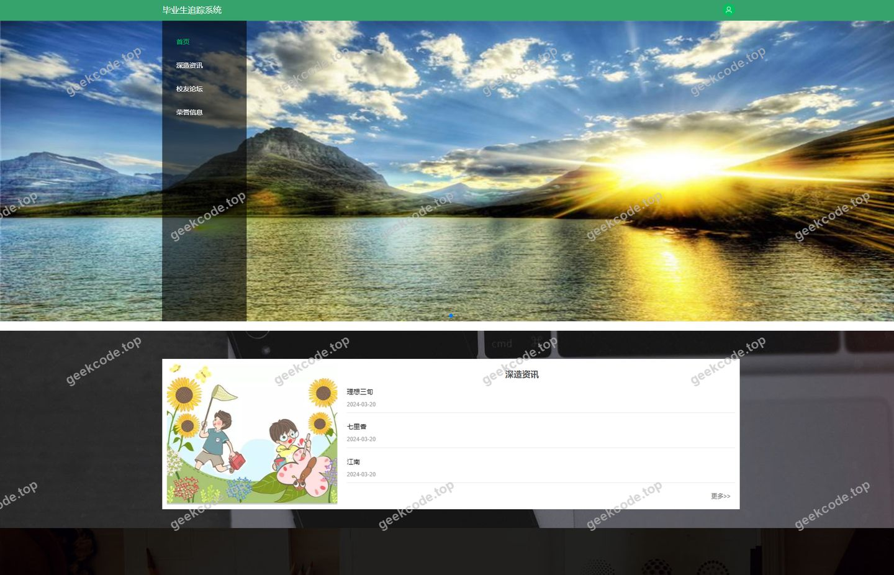</a>

<h4>前台-登录</h4>

<a href="https://geekcode.top/archives/springboot-%E6%AF%95%E4%B8%9A%E7%94%9F%E8%BF%BD%E8%B8%AA%E7%B3%BB%E7%BB%9F?utm_source=github" title="查看完整源码">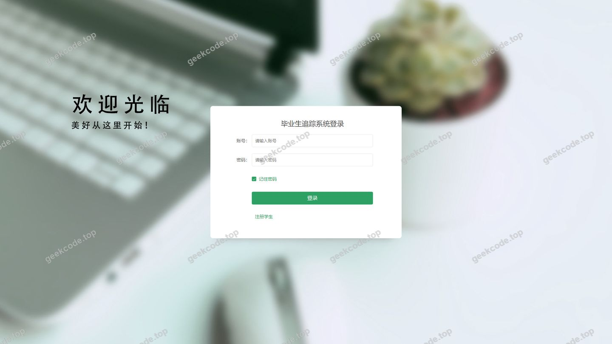</a>

<h4>前台-学生注册</h4>

<a href="https://geekcode.top/archives/springboot-%E6%AF%95%E4%B8%9A%E7%94%9F%E8%BF%BD%E8%B8%AA%E7%B3%BB%E7%BB%9F?utm_source=github" title="查看完整源码">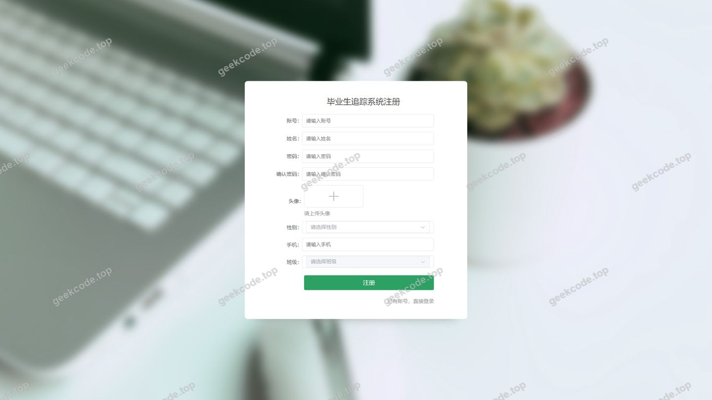</a>

<h3>后台管理端</h3>
<h4>后台-班级</h4>

<a href="https://geekcode.top/archives/springboot-%E6%AF%95%E4%B8%9A%E7%94%9F%E8%BF%BD%E8%B8%AA%E7%B3%BB%E7%BB%9F?utm_source=github" title="查看完整源码">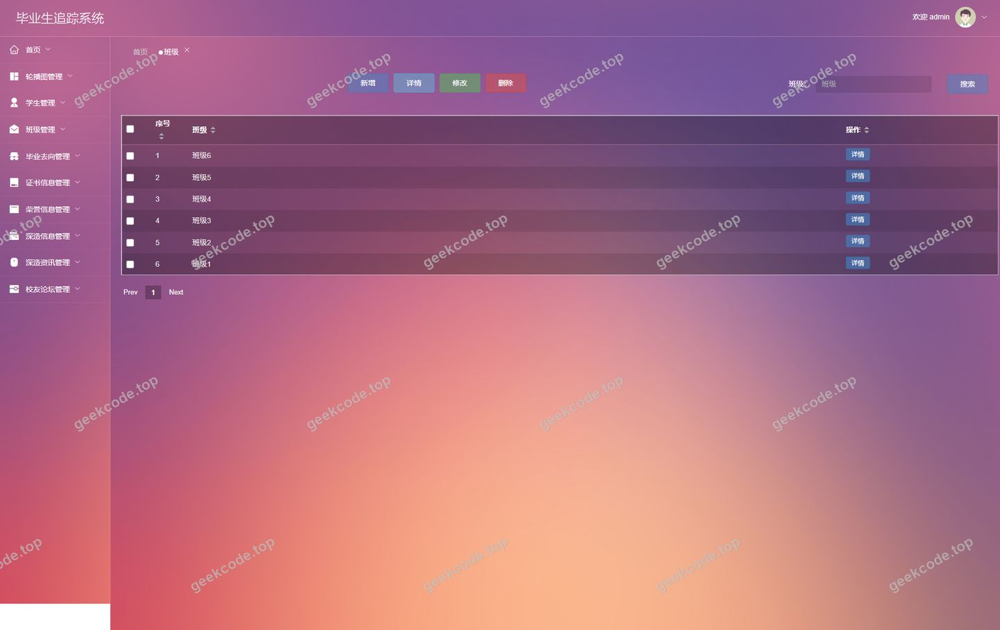</a>

<h4>后台-毕业去向</h4>

<a href="https://geekcode.top/archives/springboot-%E6%AF%95%E4%B8%9A%E7%94%9F%E8%BF%BD%E8%B8%AA%E7%B3%BB%E7%BB%9F?utm_source=github" title="查看完整源码">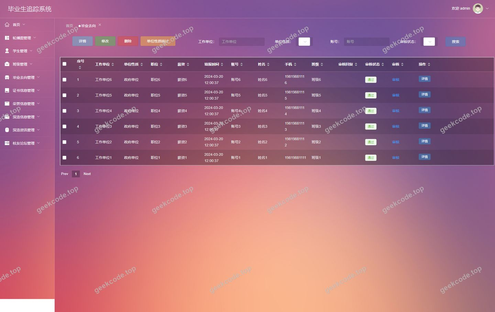</a>

<h4>后台-登录页</h4>

<a href="https://geekcode.top/archives/springboot-%E6%AF%95%E4%B8%9A%E7%94%9F%E8%BF%BD%E8%B8%AA%E7%B3%BB%E7%BB%9F?utm_source=github" title="查看完整源码">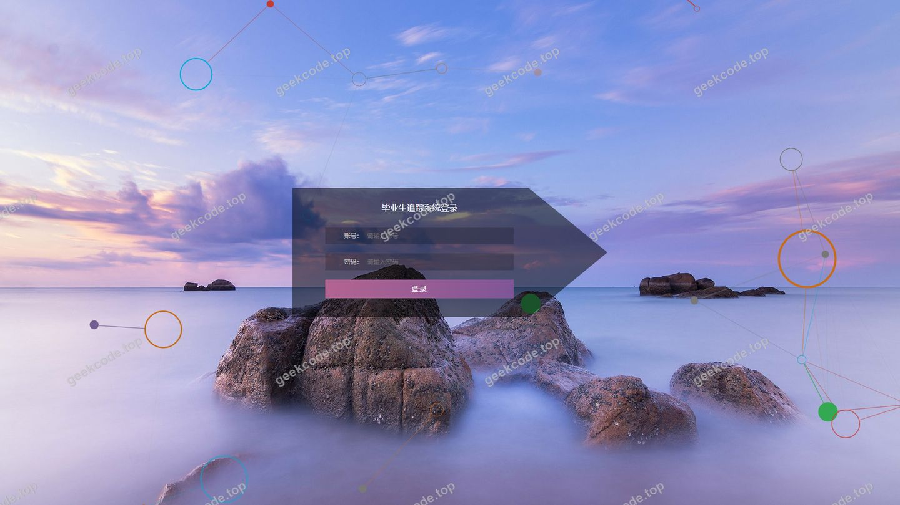</a>

<h4>后台-轮播图</h4>

<a href="https://geekcode.top/archives/springboot-%E6%AF%95%E4%B8%9A%E7%94%9F%E8%BF%BD%E8%B8%AA%E7%B3%BB%E7%BB%9F?utm_source=github" title="查看完整源码">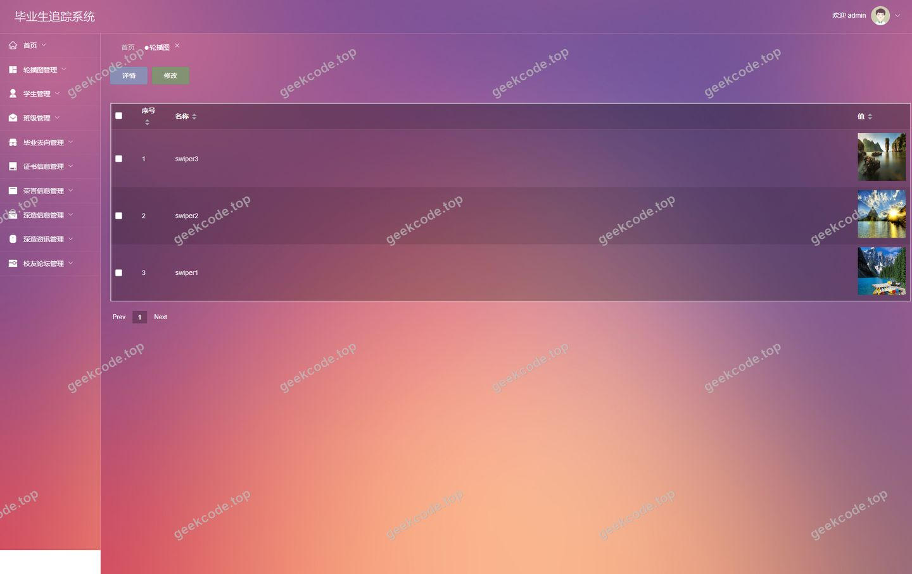</a>

<h4>后台-荣誉信息</h4>

<a href="https://geekcode.top/archives/springboot-%E6%AF%95%E4%B8%9A%E7%94%9F%E8%BF%BD%E8%B8%AA%E7%B3%BB%E7%BB%9F?utm_source=github" title="查看完整源码">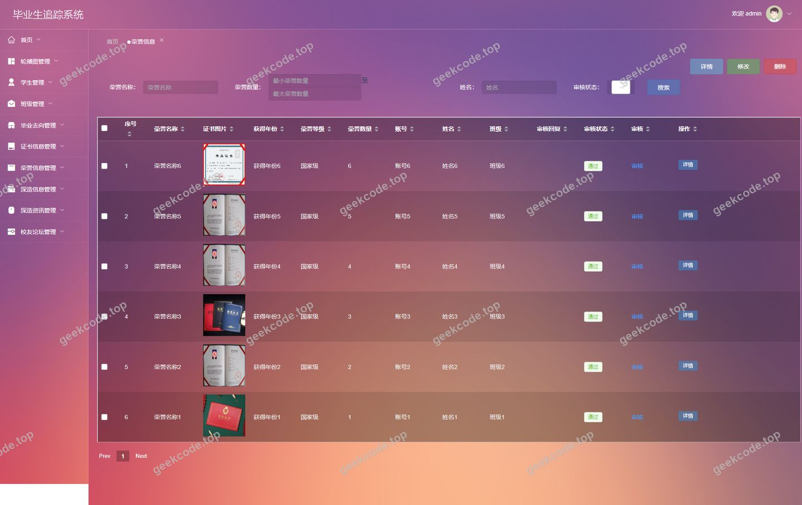</a>

<h4>后台-深造资讯</h4>

<a href="https://geekcode.top/archives/springboot-%E6%AF%95%E4%B8%9A%E7%94%9F%E8%BF%BD%E8%B8%AA%E7%B3%BB%E7%BB%9F?utm_source=github" title="查看完整源码">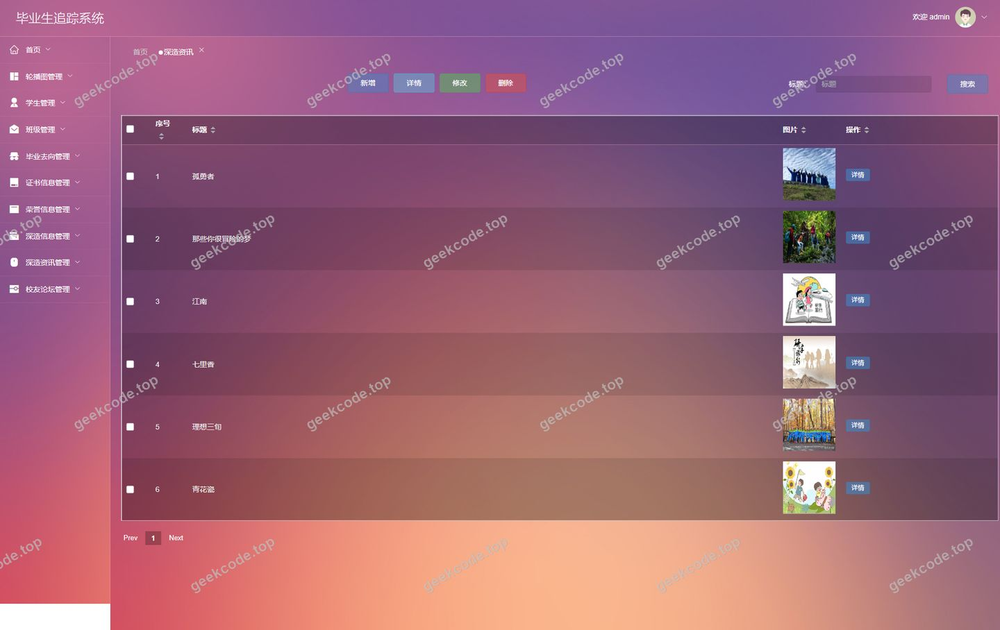</a>

<h4>页面-首页</h4>

<a href="https://geekcode.top/archives/springboot-%E6%AF%95%E4%B8%9A%E7%94%9F%E8%BF%BD%E8%B8%AA%E7%B3%BB%E7%BB%9F?utm_source=github" title="查看完整源码">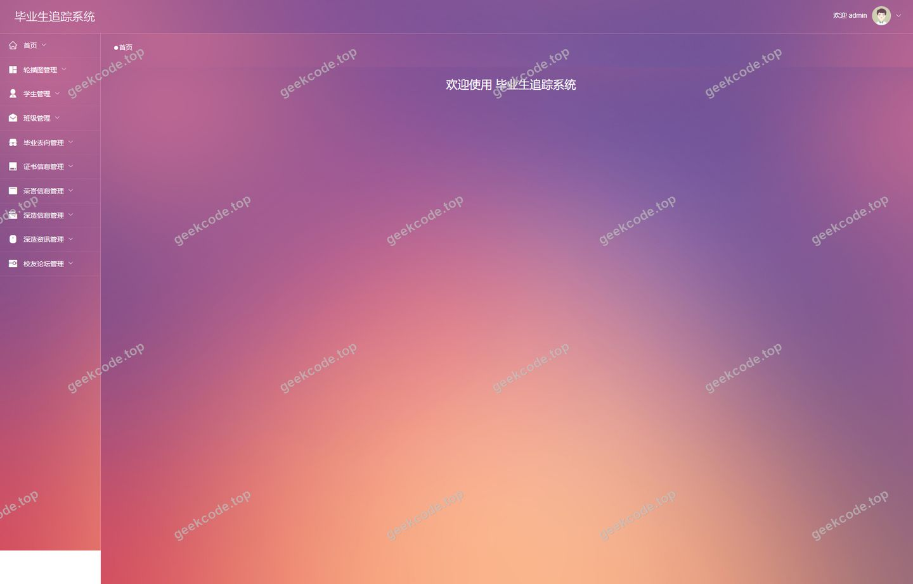</a>

<h4>后台-学生</h4>

<a href="https://geekcode.top/archives/springboot-%E6%AF%95%E4%B8%9A%E7%94%9F%E8%BF%BD%E8%B8%AA%E7%B3%BB%E7%BB%9F?utm_source=github" title="查看完整源码">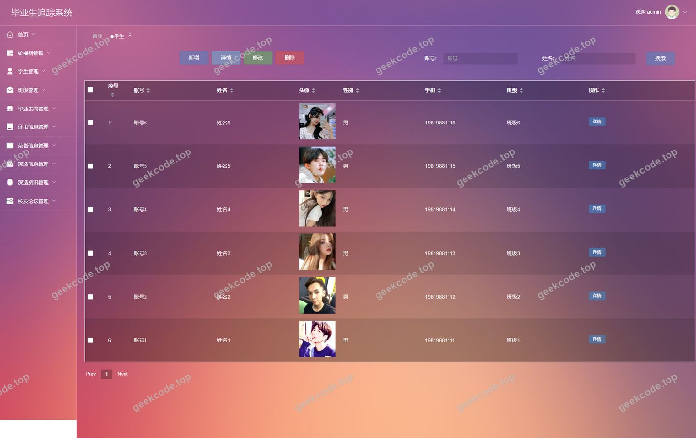</a>

---

## 获取完整源码

| 项目 | 说明 |
| --- | --- |
| 项目名 | [springboot]毕业生追踪系统 |
| 运行截图 | 本文 12 张（站点带水印原图，仓库 `images/` 目录） |
| 完整源码 | [https://geekcode.top/archives/springboot-%E6%AF%95%E4%B8%9A%E7%94%9F%E8%BF%BD%E8%B8%AA%E7%B3%BB%E7%BB%9F?utm_source=github](https://geekcode.top/archives/springboot-%E6%AF%95%E4%B8%9A%E7%94%9F%E8%BF%BD%E8%B8%AA%E7%B3%BB%E7%BB%9F?utm_source=github) |
| 咨询微信 | **ir9372**（备注：jingpin-yuanma） |
| 更多项目 | [极客代码 geekcode.top](https://geekcode.top/?utm_source=github) |

> 需要源码、部署、改配置、跑不起来等问题，加微信 ir9372 沟通，说明项目名即可。
